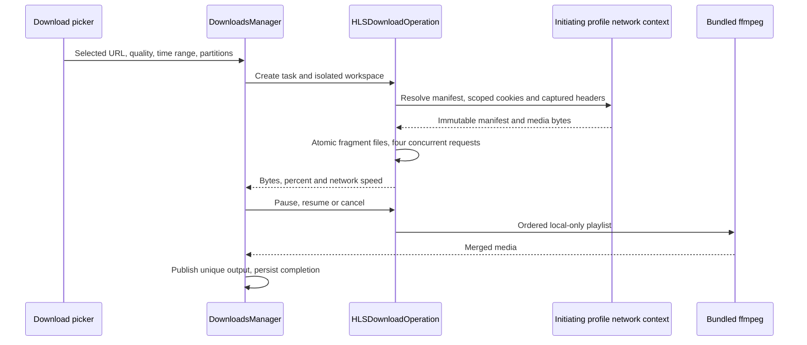

# Integrated media downloads

Astra owns media discovery and downloads in the existing tab and DownloadsManager.
A context-menu media action captures the clicked HTTP(S) source, originating page,
and cookie provider before asynchronous work. HLS sources use the existing yt-dlp
pipeline, referer, session cookies, cancellation and isolated attempt directories.
The downloads popover supports compact and expanded sizes without changing tasks.
The app bundle contains yt-dlp, ffmpeg and ffprobe plus non-system dependencies.

Xdownloader (https://github.com/bennix/Xdownloader, GPL-3.0-only) was reviewed for
behavior. Changes extend Astra's existing implementation independently.

Acceptance includes a clicked HLS URL, a clicked media page, page media discovery,
multiple candidates, cancellation, failed fragments, and expanding the download
popover while a download continues. Existing DRM checks remain enforced.

A document-start PerformanceObserver retains discovered media URLs per document,
including HLS manifests, preserving signed query parameters. Discovery combines
these entries with video/audio sources and media anchors. Explicitly clicked
URLs never fall back to downloading an unrelated resource from the containing page.

WebKit fallback pages expose the same media download actions as Chromium. The
context-menu target is captured by a document contextmenu listener before menu
selection. Preparation is visible immediately as a download task.

Media tool subprocesses inherit the local proxy selected by BrowserProxyPolicy,
including the required proxy when enabled. Metadata, media downloads and playback
resolution use the same explicit proxy. Socket operations have a 20-second timeout
so an unreachable server produces a visible failure instead of indefinite preparation.

## Live recording and network discovery

CefBrowser owns a per-page list of successful media response URLs and MIME
types. Navigation discards previous-page results. The download picker merges these
with DOM discovery and exposes playlists individually. Cookies remain scoped to
resource hosts. Cloudflare challenges require normal browser verification.

Live metadata selects ffmpeg through yt-dlp. Stop sends an interrupt to yt-dlp,
which asks ffmpeg to finalize the recording before normal postprocessing. Cancel
remains a discard operation. A selected recording duration is passed to ffmpeg as its output duration limit,
so metadata and connection startup do not consume the recording interval.
VOD selection accepts an optional start/end time range for playlist downloads.
Stream-copy range boundaries can align to nearby keyframes.

## Resource callback thread isolation

CEF invokes media response callbacks on Chrome_IOThread. Read CEF frame URLs
with direct statements on that thread, then send immutable URL values to the
main-actor media registry. Avoid nested Swift closures inheriting the owning
main-actor isolation inside the C callback. A media response must not trigger
a Swift executor assertion.

## Download progress output

yt-dlp downloads explicitly enable --progress because the after_move --print
marker implies quiet mode. Progress templates alone do not enable output.
The process reader forwards byte counts and speed to the download item.
Acceptance uses a local HTTP fixture to verify that progress and positive speed
arrive while the final file marker is still emitted.

## Media download history

The All Downloads action expands the native list in its existing popover.
Done or Escape returns to the compact list. Presentation state belongs to the
root list view so a nested sheet cannot outlive the popover that presented it.
Completed media records are stored per profile and restored when a manager is
created or refreshed. Private windows keep records in memory. Removing a record
removes its persisted entry without deleting the downloaded file. The store
merges individual records so windows cannot overwrite one another's history.

Acceptance covers completion, restart, removal, missing files, profile isolation
and private windows. Existing files without a recorded completion cannot be
reconstructed from previous in-memory sessions.

## YouTube public-access retry

A YouTube download that returns HTTP 403 with browser session arguments gets
one public-access retry. The retry omits browser cookies and the browser UA,
re-extracts metadata, and applies the existing DRM and live-stream checks.
Each attempt uses a distinct staging directory. Live recordings are never
restarted. Other failures and hosts retain their existing behavior.

## HLS parity acceptance

The native HLS path owns an immutable manifest plan before writing fragments.
It resolves master playlists with bounded recursion, preserves signed URLs,
media sequence numbers, byte ranges, initialization maps and AES-128 key state.
Unsupported encryption is rejected. Live and multi-track extraction retain the
existing media-tool path. Fragment files are published atomically and reused only
for the same resource identity. Time selection rounds outward to complete source
segments. Ordered assembly uses the original segment identities to prevent
partition overlap from duplicating media. DownloadsManager owns task cancellation,
progress, output publication and completed history.

Validation must cover relative URLs, implicit byte ranges, key rotation, maps,
missing fragments, cancellation, retry, ordered assembly and YouTube regression.
Request-header capture is restricted to media requests in the initiating tab.
Session cookies remain host-scoped and are never copied as a global header.

### Implemented transfer ownership

CEF media requests use the originating profile's Chromium request context. The
WebKit fallback uses the task-scoped APIClient session and host-scoped cookies.
Both paths validate byte-range responses. Redirected manifests resolve relative
URLs against the final response URL. Cookies are never forwarded as an unscoped
captured header. Captured headers and keys are not written to download history.

Native VOD accepts up to 4000 segments and 1–16 temporal partitions, with four
concurrent resource requests. Source sequence ownership prevents overlapping
partitions from duplicating a segment in the assembled playlist. Time ranges
include complete source segments. Live, multi-track and unsupported native
manifest layouts continue through the existing yt-dlp pipeline and DRM checks.

An interrupted task exposes Retry. Its task-scoped staging files remain available
until success or removal. Manifest identity isolates changed playlists. Keys are
fetched again and removed after the operation. Resume belongs to the current
application session; completed history remains persistent across launches.

Local integration acceptance generates TS, AES-128 and fMP4 fixtures, forces a
fragment to fail, verifies only that fragment is fetched again, merges video and
audio, checks duration and tests cancellation while paused. YouTube retry and
completed-history tests run alongside these cases.

## Sniffed URL summaries

Every candidate in the media picker includes a compact URL summary with its host,
resource path, media format and any explicit resolution present in the URL.
Resolution is a URL hint, not a probed stream property. Signed query values are
omitted from compact summaries. The selected candidate exposes its complete,
selectable URL and a Copy URL action. Selection updates both fields together.

## Complete discovered-media list

The media picker uses a scrollable list. Every unique HTTP(S) media URL discovered
in the current document has a row with its summary, selectable full address, Copy
URL action and Download action. Alternate media sources are expanded into rows.
Page extraction does not truncate to twelve candidates or hide off-screen media.
Per-document discovery retains URLs until navigation. Exact URLs are deduplicated;
signed query strings remain part of resource identity.
